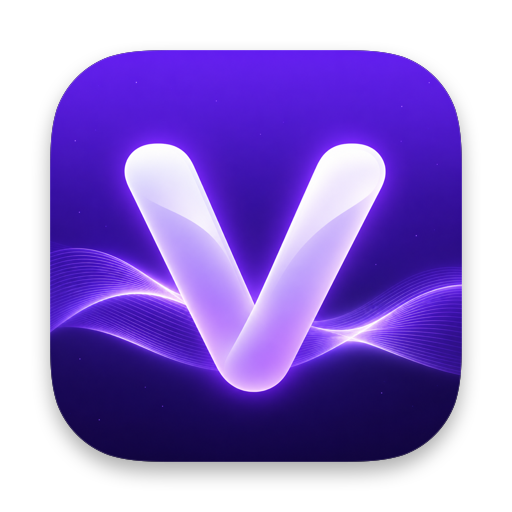
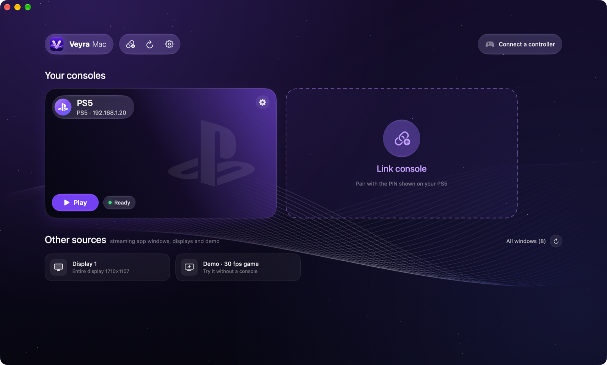
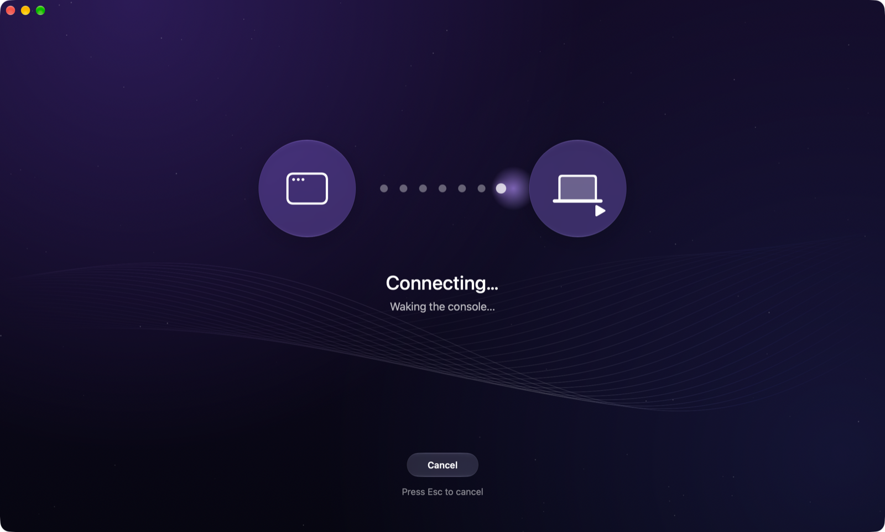
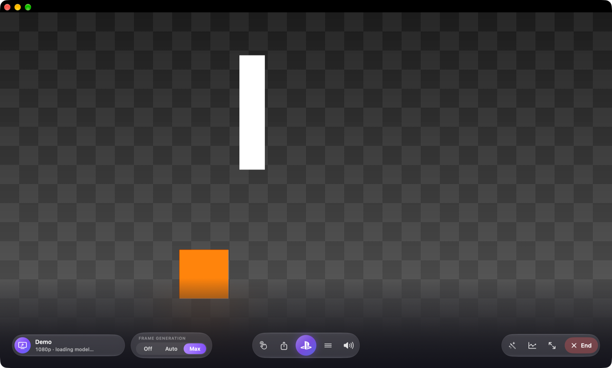

<p align="center">
  
</p>

<h1 align="center">VeyraMac</h1>

<p align="center">
  <b>PS5 Remote Play for Apple silicon Macs — with Apple's ML frame generation built in.</b><br>
  Play your 30 fps console games at a smooth 60 fps (or your display's refresh rate) on a Mac.
</p>

<p align="center">
  
  
  
</p>

<p align="center">
  
</p>

> **Unofficial project.** VeyraMac is not affiliated with, endorsed by or sponsored by Sony Interactive
> Entertainment. "PlayStation", "PS5", "DualSense" and "PS Remote Play" are trademarks of Sony Interactive
> Entertainment Inc. The Remote Play protocol is implemented by the open-source
> [chiaki-ng](https://github.com/streetpea/chiaki-ng) library. VeyraMac is inspired by
> [Veyra](https://github.com/Likely7/Veyra-NRVideo) for Windows and contains none of its code.

---

## Contents

- [Features](#features)
- [Requirements](#requirements)
- [Install](#install)
- [Quick start](#quick-start)
- [Playing](#playing)
- [Frame generation](#frame-generation)
- [Settings](#settings)
- [Performance](#performance)
- [Troubleshooting](#troubleshooting)
- [Diagnostics](#diagnostics)
- [Building from source](#building-from-source)
- [How it works](#how-it-works)
- [Privacy](#privacy)
- [Contributing](#contributing)
- [License and credits](#license-and-credits)

## Features

- **Built-in PS5 Remote Play** — pair with a code from the console, wake it from rest mode and stream
  over your local network. No other Remote Play app needed.
- **Frame generation with Apple's ML model** (`VTLowLatencyFrameInterpolation`). Every display refresh
  gets a frame from the right moment in time, so 24, 30 and 40 fps games are shown as an even 60 fps
  (or more on ProMotion and external high-refresh displays).
- **Duplicate-frame detection** — the PS5 sends 30 fps games inside a 60 fps stream; VeyraMac finds the
  real frames and interpolates between them instead of showing every frame twice.
- **Sharper image** — MetalFX upscaling to your display resolution, contrast-adaptive sharpening and ML
  super resolution for 720p and lower streams.
- **Full DualSense support** — haptics/vibration, adaptive triggers, light bar, touchpad and motion
  sensors (gyro aiming). DualShock 4 and Xbox controllers work too.
- **Console-style interface** — animated purple home screen with your consoles and recently played
  games, a full-screen connecting screen, and an in-game bar with PS / Create / Options / touchpad
  buttons that hides itself together with the cursor.
- **Up to 100 Mbps streams**, H.264 or HEVC, 1080p / 720p / 540p.
- **Honest diagnostics** — a per-second session log that tells network hitches, Mac hitches and game
  slowdowns apart, plus headless self-tests.
- English and Polish interface.

## Requirements

| | |
|---|---|
| Mac | Apple silicon (M1 or newer). Frame generation at 1080p needs about 20 ms per frame; base M-series chips handle 30 fps games comfortably. |
| macOS | 26 Tahoe or newer (Apple's frame interpolation API is new in macOS 26). |
| Console | PS5 on the same local network, with Remote Play enabled. |
| Account | Your PSN **account ID** (a number — see [Quick start](#quick-start)). |
| Controller | DualSense recommended (Bluetooth or USB). |
| Network | Wired Ethernet or 5 GHz Wi‑Fi for the console; 5/6 GHz Wi‑Fi for the Mac. |

## Install

1. Download `VeyraMac-<version>.dmg` from the [Releases](https://github.com/pkozubski/VeyraMac/releases/latest) page.
2. Open it and drag **VeyraMac** to **Applications**.
3. First launch: release builds without an Apple Developer ID signature are blocked by Gatekeeper.
   Open the app once and click **Done** when macOS says it can't verify it. Then open
   **System Settings → Privacy & Security**, click **Open Anyway** next to "VeyraMac was blocked…",
   authenticate and confirm. Alternatively, in Terminal:

   ```bash
   xattr -dr com.apple.quarantine /Applications/VeyraMac.app
   ```

4. Allow **Local Network** access when macOS asks — it is required to find and talk to the console.

> Updating an unsigned build: macOS treats every ad-hoc build as a new app, so it may ask again for
> Screen Recording (only used for "Other sources") and for access to the saved pairing keys in the
> Keychain — click **Always Allow**.

## Quick start

### 1. Enable Remote Play on the PS5

**Settings → System → Remote Play → Enable Remote Play.** To be able to wake the console from VeyraMac,
also enable **Settings → System → Power Saving → Features Available in Rest Mode → Stay Connected to the
Internet** and **Enable Turning On PS5 from Network**.

### 2. Find your PSN account ID

The account ID is a number assigned to your PSN account (not your Online ID / user name). It is shown
as a long decimal number or a Base64 string such as `AbCdEfGhIjk=` — VeyraMac accepts both. Community
tools such as PSNTools can look it up from your Online ID.

### 3. Link the console

1. On the PS5 open **Settings → System → Remote Play → Link Device**. The console shows an 8‑digit code.
2. In VeyraMac click **Link console** (the link button in the top bar, or **Link Console…** in the menu).
3. Pick the console from the list (or type its IP address), paste your account ID and type the code.

The pairing keys are stored in your macOS Keychain.

### 4. Play

Click **Play** on the console card. A console in rest mode is woken up first; the window switches to
full screen when the stream starts. You can cancel connecting with **Cancel**, `Esc`, or
**SHARE + OPTIONS** on the controller.

<p align="center">
  
</p>

## Playing

The picture fills the window and the cursor hides after two seconds. Move the mouse to show the bar:

<p align="center">
  
</p>

| Area | Controls |
|---|---|
| Left | Current source and game, **Frame generation** (Off / Auto / Max) |
| Center | Console buttons — **Touchpad** click, **Create**, **PS**, **Options** — and **Volume** |
| Right | **Image** (MetalFX, ML super resolution, sharpening, duplicate frames), **Quality** (resolution, codec, bitrate, vibration, adaptive triggers), **Stats**, **Full screen**, **End** |

### Keyboard shortcuts

| Shortcut | Action |
|---|---|
| Double-click | Toggle full screen |
| `Esc` | Leave full screen / cancel connecting |
| `⌘.` | End the session |
| `⌘I` | Show / hide stats |
| `⌘,` | Settings |
| `⌃⌥⌘F` | Toggle frame generation (quick A/B comparison) — works from any app |
| `⌃⌥⌘H` | Toggle stats overlay — works from any app |
| `⌃⌥⌘O` | Full screen (console) or overlay (window sources) — works from any app |

The keyboard is not forwarded to the console; use a controller to play.

Only one Remote Play client can be connected to a console at a time — quit the official PS Remote Play
app before connecting.

## Frame generation

| Mode | When it generates frames |
|---|---|
| **Off** | Never. Lowest latency. |
| **Auto** | When the game clearly doesn't fill the display (below ~85% of its refresh rate) and the Mac is fast enough for that game's frame rate. |
| **Max** | Whenever the game doesn't fill the display — also at 50–55 fps — as long as the Mac keeps up. |

What to expect on a 60 Hz display:

| Game frame rate | Result |
|---|---|
| 60 fps | Passed through untouched, no added latency. |
| 30 fps | Every other frame is generated → even 60 fps. The best case. |
| 40 fps | Real frames land between refreshes; generated frames fill the gaps → 60 fps. Needs ~20 ms per frame or less (borderline on a fanless MacBook Air). |
| 24 fps | Smoother than without generation, but some refreshes repeat a real frame. |
| 50 fps | Too fast for base M-series chips at 1080p; VeyraMac switches generation off and tells you why. |

Frame generation adds latency, because a frame can only be generated once the next real frame has
arrived. For 30 fps games expect roughly **45–60 ms** on top of the stream itself. If a frame would be
late, VeyraMac moves the display timeline back by one refresh for a while instead of stuttering, and
returns when there is headroom again. The current numbers are shown in **Stats**.

> Tip: In games with a "Performance" (60 fps) and a "Quality/Fidelity" (30 fps) mode, the 30 fps mode
> plus frame generation often looks best.

## Settings

| Setting | Where | Notes |
|---|---|---|
| Resolution (1080p / 720p / 540p) | Quality | 720p enables ML super resolution and lowers generation cost. |
| HEVC codec | Quality | Better quality at the same bitrate. |
| Bitrate (15–100 Mbps) | Quality | Default 100 Mbps; the console sends what the scene needs (typically 15–50). Lower it on weak Wi‑Fi. |
| Vibration (off / weak / normal / strong) | Quality | DualSense haptics and classic rumble. |
| Adaptive triggers | Quality | Trigger resistance and effects set by the game. |
| MetalFX upscaling | Image | Upscale to the display with MetalFX instead of bilinear filtering. |
| ML super resolution | Image | Apple's ML upscaler for streams up to 720p (1.5×). |
| Sharpening | Image | Contrast-adaptive sharpening after upscaling. |
| Skip duplicate frames | Image | Detect 30 fps games in a 60 fps stream (needed for frame generation). |
| Full screen on Play, stats, diagnostic sources | Settings (`⌘,`) | |

## Performance

Measured on a 15" MacBook Air with a base **M3** (fanless), macOS 27, 1080p HEVC stream at 60 Hz:

| | 30 fps game | 40 fps game |
|---|---|---|
| ML interpolation per frame | 18–22 ms (spikes up to ~50 ms in heavy scenes) | 20–28 ms, depends on temperature |
| Frame generation | always on | on when the Mac is cool |
| Added latency | ~45–60 ms | ~70 ms |
| Smoothness, real 1-hour session (pre-1.0 build) | 94% | — |
| Smoothness, synthetic test with display rendering and Wi‑Fi-like jitter (1.0) | 98–99% | not measured |

Faster chips (Pro/Max, newer generations) have more headroom for 40–50 fps games and 120 Hz displays.

## Troubleshooting

<details>
<summary><b>The console is not found / shows "Unavailable"</b></summary>

- Make sure the Mac and the PS5 are on the same network and subnet, and that **Local Network** access is
  allowed for VeyraMac in **System Settings → Privacy & Security → Local Network**.
- Click ↻ in the top bar to search again. If the console got a new IP address, VeyraMac updates it
  automatically when it finds the console again.
</details>

<details>
<summary><b>Connecting fails or times out</b></summary>

- Quit the official PS Remote Play app (only one client can connect).
- If the console is in rest mode, enable the rest-mode network options listed in [Quick start](#1-enable-remote-play-on-the-ps5).
- If the console asks for a login PIN, VeyraMac shows a dialog for it.
- Unpair (⚙︎ on the console card) and link again if the PS5 was reset or the account changed.
</details>

<details>
<summary><b>Stutter or "hitches" in Stats</b></summary>

Open the session log (see [Diagnostics](#diagnostics)). Each hitch is attributed to the **network**
(lost frames, gaps), the **Mac** (late frames) or the **source** (the game itself slowed down).

- Network: use Ethernet for the console, 5 GHz Wi‑Fi for the Mac, or lower the bitrate.
- Mac: close GPU-heavy apps, keep a fanless Mac cool, or switch frame generation to **Auto**.
</details>

<details>
<summary><b>Gatekeeper says the app is damaged or can't be opened</b></summary>

Unsigned release builds need **System Settings → Privacy & Security → Open Anyway**, or
`xattr -dr com.apple.quarantine /Applications/VeyraMac.app`.
</details>

## Diagnostics

### Session log

Every session writes one line per second to `~/Library/Logs/VeyraMac/session_<date>.log`. An abridged,
illustrative excerpt:

```text
# t  | network: frames lost recovered maxGap[ms] stalls Mbps | decoder: errors IDR max[ms] | pipeline: dropped dup interp avg/max[ms] late switches latency[ms] | display: new gaps1/2/3+ | score
 312 |  60  0  0    24  0  21.6 |  0  0  4.6 |  0  30 18.8/23.4  0 0  59 |  60  60/0/0 | 100%
 313 |  60  0  0    41  0  33.9 |  0  0  5.1 |  2  28 24.5/36.7  3 0  59 |  57  54/3/0 | 95%  ← hitches: 3
 314 |  60  0  0    23  0  19.0 |  0  0  4.4 |  0  30 19.2/22.1  0 0  76 |  60  60/0/0 | 100%
# End: 3513 s, smoothness 94.6%, hitches 4881 (network 1179, Mac 3578, source 124)
```

How to read it: 60 frames arrived from the console, 30 of them were duplicates (a 30 fps game),
interpolation took 18.8 ms on average, every display refresh got a new frame (`60/0/0`). In second 313
three frames were late, so the next second the display timeline moved back by one refresh
(latency 59 → 76 ms) and the hitches stopped. Seconds where the console only sends duplicates (menus,
loading) are marked `static image` and are not scored.

### Self-tests

The app binary has headless test modes. They don't need a console (except `--discover`).

```bash
# Frame generation on a synthetic 30 fps game in a 60 fps stream, with full-screen rendering
# through MetalFX and up to 8 ms of Wi‑Fi-like arrival jitter:
/Applications/VeyraMac.app/Contents/MacOS/VeyraMac --selftest fps30in60 --always --render --jitter 8 --seconds 8
```

```text
Source: Test pattern 30 fps in a 60 fps stream, 1920×1080, arrival jitter up to 8 ms
Rendering: every new frame through MetalFX to 2880×1864
[ 1 s] canvas 1920x1080 image 1920x1080  61.9 fps (unique 31.7)  output 62.1 fps 1920x1080  FG skipped(30) 0.00 ms  SR off 0.00 ms  latency +4.3 ms
[ 2 s] canvas 1920x1080 image 1920x1080  60.1 fps (unique 29.9)  output 44.5 fps 1920x1080  FG active(30→display) 19.84 ms  SR off 0.00 ms  latency +37.6 ms
...
[ 8 s] canvas 1920x1080 image 1920x1080  60.3 fps (unique 30.0)  output 59.9 fps 1920x1080  FG active(30→display) 18.59 ms  SR off 0.00 ms  latency +76.0 ms
Simulated display 60 Hz: 483 refreshes, 466 new frames (58.2 fps, 198 of them generated), 17 refreshes without a new frame
On-screen motion: mean 16.57 ms of content per refresh, deviation median 0.19 ms, p95 8.30 ms, max 19.50 ms; refreshes without motion 7 (1.9%)
Model warm-up (in background): 22 / 14 / 13 / 13 / 13 / 13 ms
```

"On-screen motion" is the key number: with even motion every refresh advances the game by the same
16.7 ms, so the median deviation should be close to zero.

| Command | What it does |
|---|---|
| `--selftest <cadence>` | Synthetic source through the full pipeline. Cadences: `fps30`, `fps60`, `fps30in60`, `fps24in60`, `fps40in60`, `fps50in60`. Options: `--seconds N`, `--size 1280x720`, `--hz 120`, `--always`, `--off`, `--sr`, `--render`, `--jitter MS`, `--log`, `--dump DIR` (writes frames after the renderer as PNG). |
| `--discover` | Finds PlayStation consoles on the local network. Prints e.g. `PS5  state: ready  game: —`. |
| `--motion-test [--seconds 15]` | Prints the controller's gyro and accelerometer in the axes sent to the console. |
| `--decode-test FILE [--hevc]` | Feeds an Annex B H.264/HEVC file through the same decoder Remote Play uses. |
| `--rp-dry-run` | Starts a session with empty keys; the console must refuse — tests error handling. |
| `--list-windows`, `--capture-test NAME` | Window capture sources (needs Screen Recording permission). |
| `--ui-test DIR [--demo-console]` | Saves screenshots of the home, connecting and in-game screens. Run it with `open -n -W build/VeyraMac.app --args --ui-test DIR` on an unlocked, awake screen. |

## Building from source

Requirements: Apple silicon Mac, macOS 26+, Xcode 26+ and [Homebrew](https://brew.sh).

```bash
brew install xcodegen cmake pkgconf protobuf miniupnpc libevent json-c opus openssl@3 curl
```

```bash
git clone https://github.com/pkozubski/VeyraMac.git && cd VeyraMac
Scripts/build-chiaki.sh   # fetches chiaki-ng at a pinned commit into Vendor/ and builds it (once)
Scripts/build.sh          # builds build/VeyraMac.app for this Mac
open build/VeyraMac.app
```

`Scripts/build.sh` is for development: it links the Homebrew libraries dynamically and signs the app
with the first code-signing identity in your keychain (or `VEYRAMAC_SIGN_IDENTITY`), so macOS
remembers permissions between rebuilds. The result only runs on a Mac with those Homebrew packages.

### Release build

```bash
Scripts/release.sh
```

This produces `dist/VeyraMac-<version>.dmg` and `.zip` that run on any Apple silicon Mac with macOS 26
or newer, without Homebrew: chiaki-ng's dependencies are linked statically, libcurl comes from macOS,
and the script fails if the binary references anything outside the system or requires a newer macOS.
The hardened runtime is enabled.

By default the app is signed **ad hoc** (users see the Gatekeeper prompt described in
[Install](#install)). With an Apple Developer Program membership you can sign and notarize:

```bash
xcrun notarytool store-credentials veyramac-notary --apple-id <apple-id> --team-id <TEAMID>
VEYRAMAC_RELEASE_IDENTITY="Developer ID Application: <Name> (<TEAMID>)" \
VEYRAMAC_NOTARY_PROFILE=veyramac-notary \
Scripts/release.sh
```

The release script never uses an "Apple Development" certificate, because it would embed the
developer's e-mail address in a public download.

### Other scripts

| Script | Purpose |
|---|---|
| `Scripts/make-icon.swift` | Rebuilds `AppIcon.appiconset` from `Support/Icon/icon-art.png` (macOS icon grid, shadow, all sizes). |

### Localization

English is the development language. Translations live in
`Sources/VeyraMac/Resources/Localizable.xcstrings` (Polish today). Open it in Xcode to add a language;
new strings appear there after a build.

## How it works

| Stage | Technology | Notes |
|---|---|---|
| Stream from the console | chiaki-ng | H.264 or HEVC, 1080p / 720p / 540p, 60 fps |
| Decoding | VideoToolbox `VTDecompressionSession` | Hardware decode to NV12 |
| Duplicate detection | Custom (luma sampling) | Finds 30 fps games inside a 60 fps stream |
| Frame timing | Custom phase-locked loop | Estimates when the game rendered each frame (a 40 fps game arrives every 17 and 33 ms but renders every 25 ms) |
| Frame generation | VideoToolbox `VTLowLatencyFrameInterpolation` | Frames at the exact phase each display refresh needs |
| ML super resolution | VideoToolbox `VTLowLatencySuperResolutionScaler` | Streams up to 720p |
| Upscaling to the display | MetalFX Spatial | Plus contrast-adaptive sharpening |
| Presentation | Metal + `CAMetalDisplayLink` | Each frame has a deadline on the display's refresh grid |
| Audio | Opus → AVAudioEngine | ~40–60 ms buffer |
| Controller | GameController + CoreHaptics | DualSense haptics, adaptive triggers, gyro, touchpad |

```
Sources/VeyraMac
├── App/          App model, self-tests, UI tests, game library (snapshots, recently played)
├── Capture/      Screen/window capture source and the synthetic test pattern
├── Pipeline/     Duplicate detection, frame generation scheduling, VideoToolbox processors, session log
├── RemotePlay/   chiaki-ng bridge (C), session, video decoder, audio, controller input and feedback
├── Render/       Metal renderer, MetalFX, display link, present queue
└── UI/           SwiftUI screens: home, connecting, in-game bar, settings
```

## Privacy

- Everything stays on your Mac and your local network. VeyraMac has no analytics and no servers.
- Pairing keys are stored in the macOS Keychain.
- Session snapshots (console card backgrounds, recently played) are stored in
  `~/Library/Application Support/VeyraMac/Snapshots`; session logs in `~/Library/Logs/VeyraMac`.
  Delete the folders to remove them.

## Contributing

Issues and pull requests are welcome. Before opening a PR:

1. Build with `Scripts/build.sh` and run the self-tests from [Diagnostics](#diagnostics).
2. For timing or frame-generation changes, include a self-test run and, if possible, a session log
   from a real game.
3. Keep user-facing text localizable (`Text("…")` / `String(localized:)`) and add the Polish translation
   to `Localizable.xcstrings`.

## License and credits

VeyraMac is free software under the **GNU Affero General Public License v3.0 only**, with the same
additional permission for linking OpenSSL that chiaki-ng uses — see [LICENSE](LICENSE). Because the app
links chiaki-ng (AGPL-3.0), any distributed modified version must also be released under the AGPL with
its source code.

- [chiaki-ng](https://github.com/streetpea/chiaki-ng) — the PS Remote Play protocol implementation.
- [Veyra](https://github.com/Likely7/Veyra-NRVideo) — the Windows project that inspired this one.
- Third-party libraries and their licenses: [THIRD_PARTY_NOTICES.md](THIRD_PARTY_NOTICES.md).
